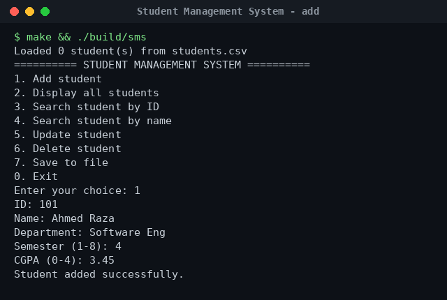
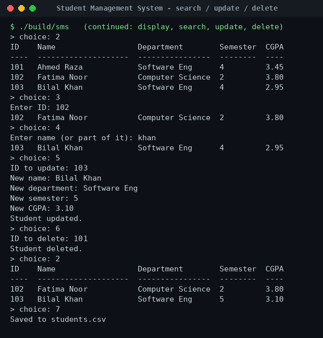
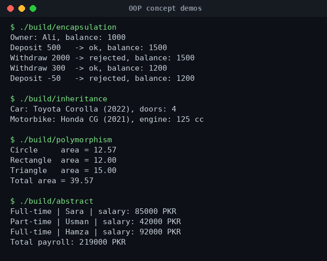

# OOP Projects in C++


Object-Oriented Programming coursework from my BS Software Engineering degree at Superior University. The main project is a **Student Management System** console application, plus four short programs that each show one core OOP concept.

## Contents

| Folder / file | What it shows |
|---|---|
| `student-management-system/` | Full CRUD console app with classes, encapsulation and file storage |
| `oop-concepts/01_encapsulation_bank_account.cpp` | Private data + validated public methods |
| `oop-concepts/02_inheritance_vehicles.cpp` | Base class `Vehicle` → `Car`, `Motorbike` |
| `oop-concepts/03_polymorphism_shapes.cpp` | Virtual functions, `Shape*` calling the right `area()` |
| `oop-concepts/04_abstract_class_employees.cpp` | Pure virtual functions and an abstract base class |

## Student Management System

### Features

- **Add** a student (ID, name, department, semester, CGPA) — duplicate IDs are rejected
- **Display** all students in a formatted table
- **Search** by ID or by part of the name (case-insensitive)
- **Update** and **delete** records
- **Save / load** all records to `students.csv` automatically
- **Input validation** — semester must be 1–8 and CGPA 0.00–4.00

### Class design

```
Student                         StudentManager
---------------------------     ------------------------------------
- id : int                      - students : vector<Student>
- name : string                 - fileName : string
- department : string           + addStudent(Student) : bool
- semester : int                + deleteStudent(id) : bool
- cgpa : double                 + updateStudent(...) : bool
+ getters / setters             + searchById(id) : const Student*
+ setCgpa(double) : bool        + searchByName(text) : vector<Student>
+ toCsv() / fromCsv()           + saveToFile() / loadFromFile()
```

`StudentManager` *has many* `Student` objects (composition). All data members are private, and setters validate input before changing anything.

### Build & run

```bash
make            # builds everything into ./build
./build/sms     # Student Management System
```

Or compile only the app by hand:

```bash
g++ -std=c++17 -Wall student-management-system/*.cpp -o sms
./sms
```

### Screenshots





## OOP concept demos

```bash
./build/encapsulation
./build/inheritance
./build/polymorphism
./build/abstract
```



## What I practised

- Designing classes with clear responsibilities
- Encapsulation and input validation in setters
- Inheritance, virtual functions and abstract classes
- `std::vector`, `std::unique_ptr`, file streams and string parsing
- Writing a `Makefile` and compiling with warnings enabled (`-Wall -Wextra`)

## Author

**Dhia Alhaq Saleh Al-Hindrish** — BS Software Engineering, Superior University, Lahore
GitHub: [@dhiaalhaq7979](https://github.com/dhiaalhaq7979)
